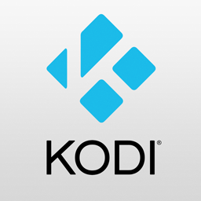

<p align="center">
  
</p>

<h1 align="center">Kodi for Nintendo Switch 2</h1>

<p align="center">
  Kodi 21.3 "Omega" built for the Switch 2 as a native homebrew app, launched from hbmenu under kaiHEN.
</p>

<p align="center">
  
  
  
  
  
</p>

<p align="center">
  
  
</p>

## Status

It boots, it's usable with a controller, and it plays real files. Everything below was checked on a retail Switch 2;
the details are in [TESTING.md](TESTING.md).

| Area | State |
|---|---|
| Startup | Estuary home screen in about 25 s from hbmenu. 1920×1080 GUI on OpenGL ES 3.2 (Mesa zink over NVK). |
| Input | Controller navigation with key repeat. A select, B back, X context menu, Y info, +/− menu and OSD, L/R page, ZL/ZR rewind and fast-forward. |
| Video | FFmpeg software decoding. H.264 and HEVC, 8- and 10-bit, up to 2160p. SDR plays in real time. |
| HDR10 | Plays, tone-mapped to SDR. No HDR output. |
| Audio | PCM, AC3, E-AC3, DTS, DTS-HD MA, AAC (up to 7.1) and FLAC are decoded and mixed down to stereo. |
| Network | HTTP sources on the LAN work, including a 31 Mb/s Blu-ray remux. Seeks and chapter jumps resume in under 2 s. |
| Local files | Plays from the SD card. |
| Exit | HOME → Close shuts Kodi down cleanly and saves settings and databases. |

<p align="center">
  
  
</p>

## Limitations

This is an early port, tested on a single console.

- No Python add-ons yet, so the usual scraper and streaming plugins don't work. Binary add-ons aren't supported
  either, because the platform has no `dlopen`.
- Decoding is software only. 4K HEVC 10-bit HDR runs about 10% slower than real time.
- Audio output is stereo. Surround tracks are decoded and mixed down; there's no passthrough.
- No HDR output. HDR10 is tone-mapped.
- Docked mode hasn't been tested, and the GUI is fixed at 1920×1080.
- SMB, NFS, UPnP, AirPlay, the web server, the JSON-RPC remote and automatic add-on updates are off or not built.
  HTTP sources work.
- Audio hasn't been checked by ear yet. The rig captures video only; the audio sink runs without errors.
- Touch, subtitles, the music library, Pictures, PVR and Games are untested.

## Install

You need a Switch 2 running kaiHEN with hbmenu.

1. Download the zip from [Releases](https://github.com/ignotusbucius/kodi-ns2/releases), or build it yourself (below).
2. Unzip it onto the SD card so you end up with:
   ```
   sdmc:/switch/kodi.nro
   sdmc:/switch/kodi/        addons/, media/, system/, userdata/
   ```
3. Start *Kodi* from hbmenu.
4. Add a source under *Videos → Files → Add videos…*, or put a `sources.xml` in `sdmc:/switch/kodi/.kodi/userdata/`.

Kodi keeps its data in `sdmc:/switch/kodi/.kodi/` and its log in `sdmc:/switch/kodi/.kodi/temp/kodi.log`. It only
writes under `sdmc:/switch/kodi/`, and every build is checked to make sure it links no NAND, save-data or
system-settings calls.

## Build

You need a Linux host with Podman or Docker. The build uses the
[ounce-devkit](https://github.com/ouncebrew/ounce-devkit) image (devkitPro, libounce and OunceVK).

```bash
# devkit image, once
git clone https://github.com/ouncebrew/ounce-devkit && podman build -t ounce-devkit ounce-devkit
podman build -t kodi-switch2-devkit -f Containerfile .

# Kodi 21.3 plus this port
./bootstrap.sh       # clones xbmc/xbmc at 21.3-Omega into ./xbmc and applies the patch

# build everything
./build.sh all       # hosttools, deps, configure, build, nro
ls out/switch/       # kodi.nro and kodi/
```

Stages can be run one at a time with `./build.sh hosttools|deps|configure|build|nro`. The libraries the devkit
lacks (libiconv, OpenSSL 3.0, SQLite, TinyXML, libcdio, FFmpeg 6.0.1, fstrcmp and a small libuuid) are built
statically into `prefix/`.

## How the port works

The port adds a `switch2` platform to Kodi's build: CMake platform files, `xbmc/platform/switch2`, an EGL/GLES
window system on the default NWindow, and an `audout` audio sink. The rest is a handful of small shims for places
where the console's newlib/libounce runtime behaves differently from Linux. Each of these turned up on hardware:

| On the Switch 2 | Effect on Kodi | Fix |
|---|---|---|
| `read()` past end-of-file returns EIO instead of 0 | SQLite saw every new database as corrupt | Read wrapper clamps to the file size |
| `stat()` on a file open for writing returns EIO | SQLite `IOERR_FSTAT` | `stat`/`lstat` fall back to the entry type and our own fd |
| A second `open()` of a file open for writing fails | Kodi's second database connection failed | SQLite shared cache; file cache kept in RAM |
| No POSIX advisory locks | SQLite lock errors | `unix-dotfile` VFS |
| `pthread_detach()` always fails | `std::thread::detach` threw and Kodi aborted | Detached threads are handed to a reaper that joins them |
| Default thread stack is 128 KiB | Risk of overflow in deep call chains | 1 MiB default stack |
| `CLOCK_MONOTONIC_RAW` isn't supported | Garbage media clock; a 30 s clip finished in 3 s | Use `CLOCK_MONOTONIC` and map the other clock IDs |
| No `dlopen`, `/proc`, `sysinfo`, `uname` or `mmap` | Build and link errors | Stubs and compatibility headers |

There's also a small crash handler that writes the registers, module base and a backtrace to
`sdmc:/switch/kodi/crash.txt`.

## Roadmap

1. Repeat the network playback test on a fresh launch, and check the audio by ear.
2. Get 4K HDR10 to full speed by fixing the 10-bit shader rebuilds, and measure dropped frames.
3. Hardware decoding through NVDEC.
4. Docked and TV output: follow the dock's resolution, 4K GUI, refresh-rate switching, HDR.
5. Surround audio and passthrough.
6. SMB, NFS, UPnP and the JSON-RPC remote.
7. Python add-ons, by cross-building CPython for libounce.
8. Long sessions, sleep and resume, memory use.

More detail in [ROADMAP.md](ROADMAP.md).

## Credits and license

- [Kodi](https://kodi.tv) is © Team Kodi and licensed GPL-2.0-or-later. Kodi® and the Kodi logo are trademarks of
  the XBMC Foundation. This is an unofficial port, not endorsed by Team Kodi or the XBMC Foundation.
- Switch 2 port by [@ignotusbucius](https://github.com/ignotusbucius), under the same license as Kodi.
- kaiHEN, libounce, OunceVK and ounce-devkit by [ouncebrew](https://github.com/ouncebrew); devkitPro and libnx.
- FFmpeg, OpenSSL, SQLite, libiconv, libcdio, TinyXML, fstrcmp and Mesa are under their own licenses.
- Not affiliated with Nintendo. Use it on hardware you own.
