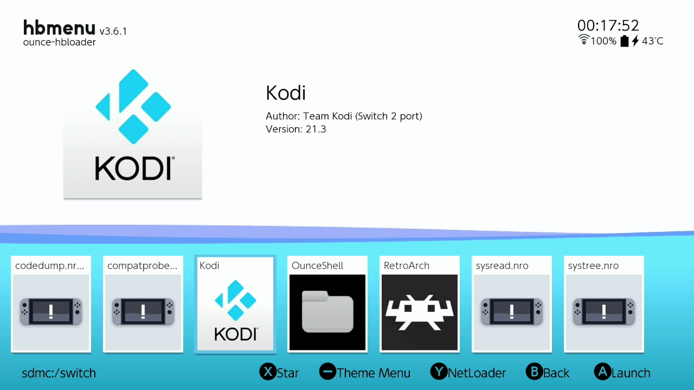
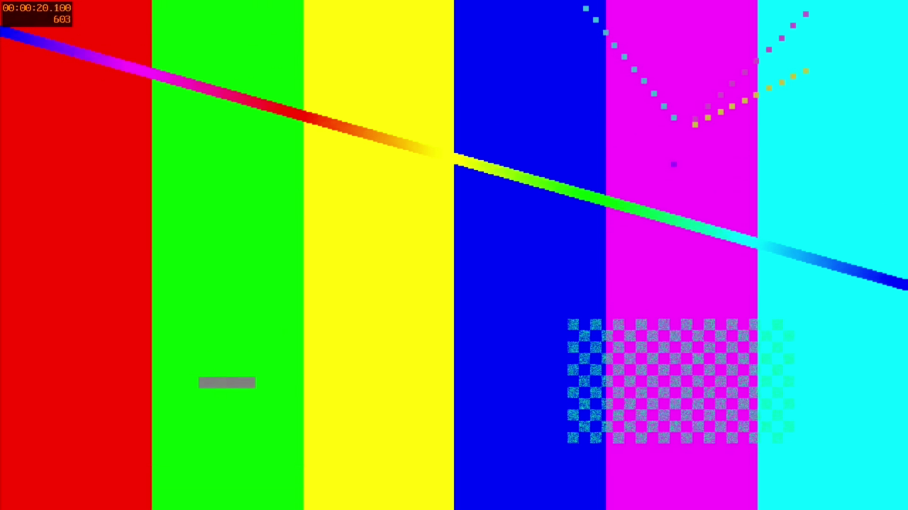

<p align="center">
  
</p>

<h1 align="center">Kodi for Nintendo Switch 2</h1>

<p align="center">
  <b>Kodi 21.3 “Omega” running natively on the Switch 2 — homebrew, via kaiHEN + hbmenu.</b><br>
  <i>Early, experimental, but it plays a 31 Mb/s Blu-ray remux. Over Wi-Fi. While you scrub.</i>
</p>

<p align="center">
  
  
  
  
  
</p>

<p align="center">
  
  
</p>

---

## What works (tested on real hardware)

| | |
|---|---|
| 🏠 **Boots to the Estuary home screen** | ~25 s cold start from hbmenu, 1920×1080 GUI, OpenGL ES 3.2 (Mesa zink → NVK on the Switch 2 GPU) |
| 🎮 **Controller** | D-pad / sticks navigate, A select, B back, X context, Y info, +/− menu/OSD, L/R page, ZL/ZR rew/ffwd, key auto-repeat |
| 🎬 **Video playback** | FFmpeg software decode: H.264 and HEVC (8- and 10-bit) up to **2160p**, real time for SDR |
| 🌈 **HDR10** | Plays; tone-mapped to SDR (Reinhard) — no HDR output yet |
| 🔊 **Audio decode** | PCM, AC3 5.1, E-AC3 5.1, DTS 5.1, DTS-HD MA 5.1, AAC 7.1, FLAC — decoded and downmixed to stereo (console `audout`) |
| 🌐 **Network streaming** | Plays from an HTTP source on the LAN, incl. a **31 Mb/s** H.264 remux; seeking / chapter jumps resume in < 2 s |
| 💾 **Local files** | Plays from the SD card (`/switch/kodi-media/…`) |
| ⏹️ **Clean exit** | HOME → Close shuts Kodi down cleanly, settings + databases saved |

<p align="center">
  
  
</p>

Full results, method and logs: **[TESTING.md](TESTING.md)**.

## ⚠️ Limitations (read these)

- **Experimental.** Built and tested on one console. Expect rough edges.
- **No Python add-ons.** Python isn't built yet, so the usual scraper/streaming plugins (YouTube etc.) do not work.
  No binary add-ons either (the platform has no `dlopen`).
- **Software decoding only.** No NVDEC hardware decoding yet → 4K HEVC 10-bit HDR runs ~10 % slower than real time.
- **Stereo out only.** 5.1/7.1 is decoded and downmixed; no passthrough, no multichannel HDMI.
- **No HDR output.** HDR10 is tone-mapped to SDR.
- **Docked / TV mode untested.** The GUI is fixed at 1920×1080.
- **Off by default / not built:** SMB, NFS, UPnP, AirPlay, web server, JSON-RPC remote, event server, add-on repository
  auto-update (the test console is kept offline). Sources over **HTTP** work.
- **Audio has not been verified by ear** (the test rig captures video only) — the sink opens, consumes and closes with
  no errors.
- Touch input, subtitles, music library, Pictures, PVR and Games are untested.

## Install

Requirements: a Switch 2 running **kaiHEN** with **hbmenu**.

1. Build (below) or grab `kodi.nro` + the `kodi/` data folder from a release.
2. Copy to the SD card:
   ```
   sdmc:/switch/kodi.nro
   sdmc:/switch/kodi/          ← addons/, media/, system/, userdata/
   ```
3. Launch **Kodi** from hbmenu (file list). User data lives in `sdmc:/switch/kodi/.kodi/`, the log in
   `sdmc:/switch/kodi/.kodi/temp/kodi.log`.
4. Add a source: *Videos → Files → Add videos…*, or drop a `sources.xml` into `sdmc:/switch/kodi/.kodi/userdata/`.

> Kodi writes only under `sdmc:/switch/kodi/`. The build links no NAND / save-data / system-settings services
> (checked on every build with `nm`).

## Build

Linux host with Podman (or Docker). Uses the [ounce-devkit](https://github.com/ouncebrew/ounce-devkit) image
(devkitPro + libounce + OunceVK).

```bash
# 1. devkit image (once)
git clone https://github.com/ouncebrew/ounce-devkit && podman build -t ounce-devkit ounce-devkit
podman build -t kodi-switch2-devkit -f Containerfile .

# 2. Kodi 21.3 + this port
./bootstrap.sh            # clones xbmc/xbmc @ 21.3-Omega into ./xbmc and applies patches/kodi-21.3-switch2.patch

# 3. everything else
./build.sh all            # hosttools → deps → configure → build → nro
ls out/switch/            # kodi.nro + kodi/
```

`./build.sh {hosttools|deps|configure|build|nro}` runs single stages. Deps (libiconv, OpenSSL 3.0, sqlite3,
TinyXML, libcdio, FFmpeg 6.0.1, fstrcmp, a tiny libuuid) are cross-built statically into `prefix/`.

## How the port works

A new `switch2` platform for Kodi's CMake build (`cmake/scripts/switch2`, `xbmc/platform/switch2`,
`xbmc/windowing/switch2`, `AESinkSwitch2`) plus a set of small shims for the places where the console's
newlib/libounce runtime differs from Linux. Every one of these was **found on hardware** and fixed:

| Console behaviour | What broke | Fix |
|---|---|---|
| `read()` past end-of-file returns **EIO** (POSIX: 0) | sqlite: every new DB “malformed” | `_read_r` wrapper: clamp to file size, EOF → 0 |
| `stat()` of a file open for writing returns **EIO** (fsdev reopens by path) | sqlite `IOERR_FSTAT` | global `stat`/`lstat` fallback via `fsFsGetEntryType` + own fd |
| a **second `open()`** of a file open for writing fails | Kodi's 2nd DB connection | sqlite shared-cache mode; file cache in RAM |
| no POSIX advisory locks | sqlite lock errors | `unix-dotfile` VFS |
| `pthread_detach()` is an **ENOSYS stub** | `std::thread::detach` throws → terminate | wrapper hands threads to a reaper that joins them |
| default thread stack **128 KiB** | deep-stack risk | `pthread_create` wrapper: 1 MiB |
| `CLOCK_MONOTONIC_RAW` unsupported (timespec left unwritten) | garbage media clock, 30 s clip in 3 s | `CLOCK_MONOTONIC` + `clock_gettime` id mapping |
| no `dlopen`, no `/proc`, no `sysinfo`/`uname`/`mmap`… | link/compile errors | stubs + compat headers |

Plus: an in-process crash handler that writes registers, module base and a backtrace to
`sdmc:/switch/kodi/crash.txt`.

## Roadmap / next steps

1. Second-run replicate of the real-media test; audio check by ear (downmix channel mapping).
2. 4K HDR10 at full speed (fix the 10-bit shader rebuild loop) + frame-drop measurement.
3. **NVDEC hardware decoding**.
4. Docked/TV output: follow dock resolution, 4K GUI, refresh-rate switching, HDR.
5. Multichannel audio / passthrough.
6. SMB/NFS/UPnP, JSON-RPC remote.
7. **Python add-ons** (cross-build CPython for libounce).
8. Long-session stability, sleep/resume, memory.
9. Release zips.

See [ROADMAP.md](ROADMAP.md).

## Credits & license

- **[Kodi](https://kodi.tv)** © Team Kodi — GPL-2.0-or-later. Kodi® and the Kodi logo are trademarks of the XBMC
  Foundation; this is an **unofficial** port and is not endorsed by Team Kodi or the XBMC Foundation.
- Switch 2 port: [@ignotusbucius](https://github.com/ignotusbucius). Port patches are GPL-2.0-or-later, as Kodi.
- [ouncebrew](https://github.com/ouncebrew): kaiHEN, libounce, OunceVK, ounce-devkit. devkitPro / libnx.
- FFmpeg, OpenSSL, SQLite, libiconv, libcdio, TinyXML, fstrcmp, Mesa — under their own licenses.
- Not affiliated with Nintendo. Use on hardware you own.
