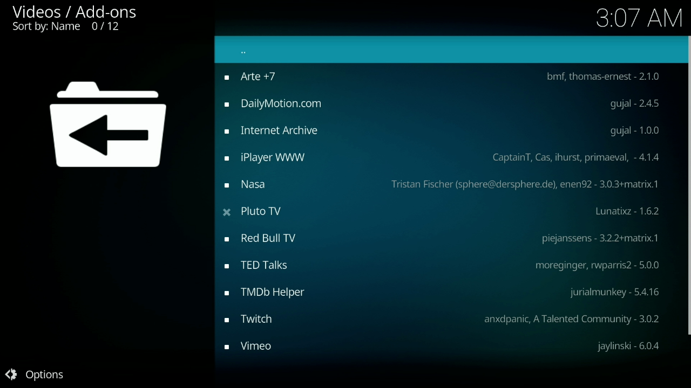
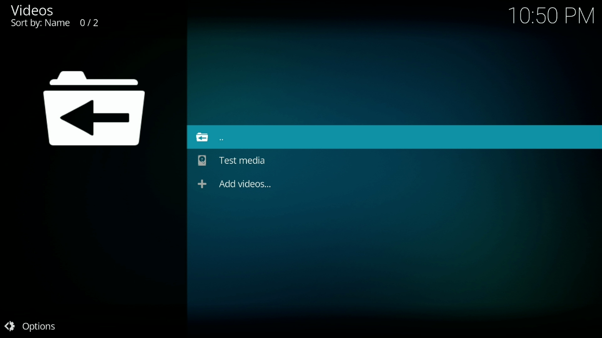

<p align="center">
  
</p>

<h1 align="center">Kodi for Nintendo Switch 2</h1>

<p align="center">
  Kodi 21.3 "Omega" as a native Switch 2 homebrew app, launched from hbmenu under kaiHEN.<br>
  4K HDR10 and AV1 in real time, Python add-ons, subtitles, a web remote, music and pictures.
</p>

<p align="center">
  
  
  
  
  
  
  
</p>

<p align="center">
  
  
</p>

## What works

Everything in this table was tested on a retail Switch 2, almost always on two separate launches. The details are in
[TESTING.md](TESTING.md).

| Area | State |
|---|---|
| Video | H.264, HEVC, **AV1** (dav1d), MPEG-2. 8- and 10-bit, **up to 2160p in real time**, including **HDR10** and 4K AV1 10-bit. 1080p60 plays smoothly. |
| HDR | HDR10 plays at full speed and is tone-mapped to SDR. |
| Audio | PCM, AC3, E-AC3, DTS, DTS-HD MA, AAC (up to 7.1), FLAC, Opus and MP3, mixed down to stereo. |
| Subtitles | Embedded SRT and ASS (with styles), external `.srt` files, and switching audio and subtitle tracks during playback. |
| Python add-ons | CPython 3.11 is built in. **41 add-ons from the official Kodi repository come pre-installed**, among them YouTube, Internet Archive, TED Talks, Vimeo, Twitch, Pluto TV, Red Bull TV, NASA, Arte, Dailymotion, iPlayer and TMDb Helper. Their menus open, service add-ons run, and `requests`/SSL work. |
| Streaming | inputstream.adaptive (HLS/DASH, no DRM) is linked in. HTTP sources on your network play, including a 31 Mb/s Blu-ray remux with fast seeking. The NFS client is built in. |
| Remote control | Kodi's web server and JSON-RPC: play, pause, stop and open files from a phone or PC. Off by default; turn it on under *Settings → Services → Control*. |
| Music and pictures | MP3, FLAC and AAC playback with playlists, and picture slideshows. |
| Input | Controller with key repeat: A select, B back, X context menu, Y info, +/− menu and OSD, L/R page, ZL/ZR rewind and fast-forward. The on-screen keyboard works for text entry. |
| Display | The GUI follows the console's output size (720p or 1080p). The screen doesn't dim or sleep while video plays. |
| Stability | 20-minute playback soaks without problems. HOME → Close exits cleanly and saves settings and databases. |

<p align="center">
  
  
</p>

## Limitations

- **No hardware decoding yet.** Everything runs on the CPU through FFmpeg. 4K HDR10 and 4K AV1 test files play
  in real time, but very high-bitrate 4K remuxes haven't been tried.
- **Stereo only**: surround tracks are decoded and mixed down, and there's no passthrough. No HDR output either;
  HDR10 is tone-mapped.
- **Binary add-ons**: the platform has no `dlopen`, so only add-ons linked into the app work (inputstream.adaptive).
  No DRM or Widevine, and no PVR clients yet.
- **Not tested yet**:
  - streaming through the add-ons over the internet (the test console runs on an isolated network);
  - NFS against a real server;
  - PGS subtitles, VC-1 and TrueHD/Atmos;
  - touch, sleep/resume, and the 4K and 720p output modes;
  - audio by ear (the rig only captures video).
- **Not available**: SMB and UPnP aren't built, and AirPlay is off.
- **One skin**: only Estuary is included, and other skins are untested. TMDb Helper's image features need Pillow,
  which isn't built yet.

## Install

You need a Switch 2 running kaiHEN with hbmenu.

1. Download `kodi-ns2-rev30.zip` from [Releases](https://github.com/ignotusbucius/kodi-ns2/releases), or build it
   yourself (below).
2. Copy the `switch` folder from the zip to the root of the SD card, merging it with the one already there:
   ```
   sdmc:/switch/kodi.nro
   sdmc:/switch/kodi/        addons/, media/, system/, userdata/
   ```
3. Start *Kodi* from hbmenu. The first start takes longer while Kodi creates its databases and scans add-ons.
4. Add media under *Videos → Files → Add videos…*. SD paths start with `/`, e.g. `/switch/kodi-media/`; you can
   also use `http://` or `nfs://` sources on your network.

**Upgrading:** unpack the new zip over the old one. Your settings, sources and libraries live in
`sdmc:/switch/kodi/.kodi/`, which the zip never contains, so they're kept. The log is at
`sdmc:/switch/kodi/.kodi/temp/kodi.log`.

Kodi only writes under `sdmc:/switch/kodi/`, and every build is checked to make sure it links no NAND, save-data
or system-settings calls.

## Build

You need a Linux host with Podman or Docker. The build uses the
[ounce-devkit](https://github.com/ouncebrew/ounce-devkit) image (devkitPro, libounce and OunceVK).

```bash
# devkit images, once
git clone https://github.com/ouncebrew/ounce-devkit && podman build -t ounce-devkit ounce-devkit
podman build -t kodi-switch2-devkit -f Containerfile .

# Kodi 21.3 plus this port
./bootstrap.sh              # clones xbmc/xbmc at 21.3-Omega into ./xbmc and applies the patch

# inputstream.adaptive (static) and the pre-installed add-ons
./isa/build.sh all          # -> isa/out/
./addons-bundle/fetch.sh    # 41 add-on zips from the official Kodi mirror, sha256-checked

# Kodi itself
./build.sh all              # hosttools, deps, configure, build, nro  -> out/switch/
./release.sh mybuild        # optional: one-zip SD install -> dist/kodi-ns2-mybuild.zip
```

Stages can be run one at a time with `./build.sh hosttools|deps|configure|build|nro`. A diagnostics build goes in
a separate tree: `BUILD_DIR=build-diag OUT_DIR=out-diag SWITCH2_DIAG=ON ./build.sh configure build nro`.

The libraries the devkit lacks are built statically into `prefix/`:

- libiconv 1.17 and OpenSSL 3.0.22;
- SQLite 3.49.2, TinyXML 2.6.2 and libcdio 2.1.0;
- dav1d 1.4.1 and FFmpeg 6.0.1;
- CPython 3.11.7, libnfs 5.0.2 and libmicrohttpd 0.9.77;
- fstrcmp and a small libuuid.

Each has its patches under `deps/patches/`.

## How the port works

The port adds a `switch2` platform to Kodi's build:

- CMake platform files and `xbmc/platform/switch2`;
- an EGL/GLES window system on the default NWindow;
- an `audout` audio sink;
- a statically linked CPython;
- inputstream.adaptive, linked into the app.

The rest is small shims for places where the console's newlib/libounce runtime behaves differently from Linux.
Each of these turned up on hardware:

| On the Switch 2 | Effect on Kodi | Fix |
|---|---|---|
| `read()` past end-of-file returns EIO instead of 0 | SQLite saw every new database as corrupt | Read wrapper clamps to the file size |
| `stat()` on a file open for writing returns EIO | SQLite `IOERR_FSTAT` | `stat`/`lstat` fall back to the entry type and our own fd |
| A second `open()` of a file open for writing fails | Kodi's second database connection failed | SQLite shared cache; file cache kept in RAM |
| No POSIX advisory locks | SQLite lock errors | `unix-dotfile` VFS |
| `pthread_detach()` always fails | `std::thread::detach` threw and Kodi aborted | Detached threads are handed to a reaper that joins them |
| Default thread stack is 128 KiB | Risk of overflow in deep call chains | 1 MiB default stack |
| `CLOCK_MONOTONIC_RAW` isn't supported | Garbage media clock; a 30 s clip finished in 3 s | Use `CLOCK_MONOTONIC` and map the other clock IDs |
| `ioctl(FIOCLEX)` works only on sockets | Python couldn't open any add-on script | `os.set_inheritable` is a no-op (CPython patch) |
| `fcntl` supports only `F_GETFL`/`F_SETFL` | Python and Kodi file locking failed | `fcntl` wrapper for dup, `FD_CLOEXEC` and locks |
| `socketpair()` isn't implemented | The web server couldn't start | Emulated over loopback TCP/UDP |
| The first OpenSSL method built on a non-main thread kills the process | Python add-ons died a few seconds after start | Every OpenSSL algorithm is fetched once on the main thread at startup (~260 ms) |
| FFmpeg's AV1 decoder is hardware-only | AV1 files didn't play | dav1d, given 4 threads |
| The console dims and sleeps during long playback | The screen went dark mid-film | Media-playback state is set while video plays |
| No `dlopen`, `/proc`, `sysinfo`, `uname` or `mmap` | Build and link errors | Stubs, compatibility headers and statically linked add-ons |

CPU exceptions don't reach homebrew on this firmware, so problems are tracked down with diagnostics builds, which
write breadcrumbs to the SD card.

## Roadmap

Short version, more detail in [ROADMAP.md](ROADMAP.md):

1. Pillow for Python add-ons, and more skins (Arctic Horizon 2, Arctic Fuse 2, Arctic Zephyr Mod).
2. USB drives, read-only.
3. Hardware decoding through NVDEC.
4. Docked and TV output: 4K GUI, refresh-rate switching, HDR output, plus handheld and undock tests.
5. Surround audio and passthrough.
6. Internet streaming through the add-ons, SMB and UPnP.
7. Long sessions: sleep and resume, memory use over hours.

## Credits and license

- [Kodi](https://kodi.tv) is © Team Kodi and licensed GPL-2.0-or-later. Kodi® and the Kodi logo are trademarks of
  the XBMC Foundation. This is an unofficial port, not endorsed by Team Kodi or the XBMC Foundation.
- Switch 2 port by [@ignotusbucius](https://github.com/ignotusbucius), under the same license as Kodi.
- kaiHEN, libounce, OunceVK and ounce-devkit by [ouncebrew](https://github.com/ouncebrew); devkitPro and libnx.
- The pre-installed add-ons come unchanged from the official Kodi repository, each under its own license (see
  their `addon.xml`).
- FFmpeg, dav1d, OpenSSL, SQLite, CPython, libnfs, libmicrohttpd, inputstream.adaptive, Bento4, libiconv, libcdio,
  TinyXML, fstrcmp and Mesa are under their own licenses.
- Not affiliated with Nintendo. Use it on hardware you own.
