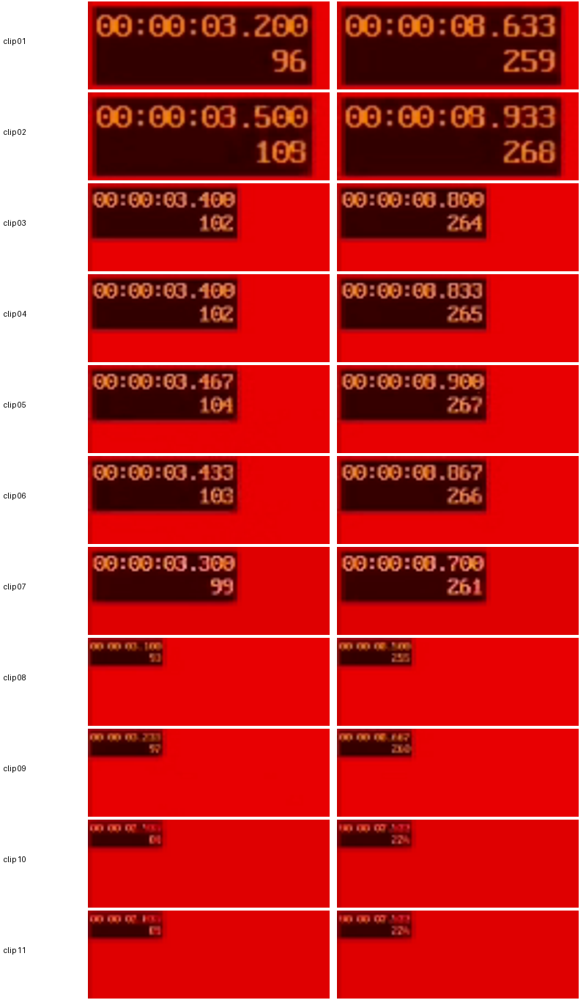

# Testing

All tests on one retail Nintendo Switch 2, firmware 23.0.1, kaiHEN + hbmenu (ounce-hbloader), Kodi launched from the
hbmenu file list, handheld for the early builds and docked at 1080p for the later ones, console on an isolated Wi-Fi
with no internet access. Input via a scripted controller, screen via a
capture card; Kodi's `kodi.log` read back over FTP after each run. Every build was reviewed before running and every
test was run on **two separate launches** unless noted.

## Bring-up history (each line = one build, 2 launches)

| Rev | Result |
|---|---|
| 3 | Splash, GLES 3.2 (zink/NVK), 1080p GUI, audio sink, add-on scan OK. First database fails ("malformed") |
| 4b | Probe: `read()` past EOF → EIO on this filesystem → sqlite reports corruption |
| 5 | Read fix works; first sqlite write → `IOERR_FSTAT` |
| 7 | `stat()` on a file open for writing → EIO; a 2nd `open()` of it → EIO; sqlite alone now works |
| 8 | sqlite shared cache → **Estuary home screen reached**; crash ~30 s later |
| 9 | `pthread_detach` is an ENOSYS stub → fixed; stays up, pad input works, clean close |
| 10 | Startup crash with media sources fixed (uninitialised DB handle); clip probed; no video renderer |
| 11 | GLES renderer registered → **picture**; media clock garbage (`CLOCK_MONOTONIC_RAW` unsupported) |
| 12 | Clock fixed → **real-time playback**, 0 A/V sync errors, clean close |

## Synthetic playback matrix (rev 12, 2 launches × 11 clips, no crash)

Clips: `testmedia/make-matrix.sh` (ffmpeg `testsrc2` with burnt-in timecode + 440 Hz tone, 12 s, MKV; HDR10 =
10-bit HEVC, BT.2020/PQ, mastering-display + CLL metadata).

| Clip | Video | Audio | Played (12 s) | Notes |
|---|---|---|---|---|
| 01 | 720p H.264 | PCM 2.0 | 12.1 s | |
| 02 | 720p HEVC | AC3 5.1 | 12.1 s | |
| 03 | 1080p H.264 | AC3 5.1 | 12.1 s | |
| 04 | 1080p H.264 | DTS 5.1 | 12.1 s | |
| 05 | 1080p HEVC | PCM 2.0 | 12.1 s | |
| 06 | 1080p HEVC | DTS 5.1 | 12.1 s | |
| 07 | 1080p HEVC 10-bit HDR10 | AC3 5.1 | 12.3–12.4 s | tone-mapped |
| 08 | 2160p H.264 25 Mb/s | AC3 5.1 | 12.1 s | |
| 09 | 2160p HEVC | DTS 5.1 | 12.1 s | |
| 10 | 2160p HEVC 10-bit HDR10 | PCM 2.0 | 13.25–13.35 s | ~10 % slow |
| 11 | 2160p HEVC 10-bit HDR10 | DTS 5.1 | 13.2–13.3 s | ~10 % slow |

The ~10 % slowdown of the 2160p HDR10 clips was fixed in rev 17 (see below): 10-bit frames now go straight to the
GLES renderer and 2160p HEVC 10-bit HDR10 plays 12 s of video in 11.7 s, like the 8-bit clips.

*Burnt-in timecode at ~4 s and ~9 s after pressing play, per clip: all advance at ~30 fps.*

## Real movies over HTTP (rev 12, 1 launch so far)

Files streamed from a PC on the LAN (plain HTTP with byte ranges), added as a Kodi video source.

| File type | Video | Audio | Result |
|---|---|---|---|
| Blu-ray remux | H.264 1080p **30.9 Mb/s** | FLAC 2.0 | plays; chapter + ±30 s seeks OK |
| Blu-ray encode | HEVC 10-bit 1080p 14 Mb/s | **DTS-HD MA 5.1** | plays; 5 seeks incl. ±10 min OK |
| Extended-cut encode | HEVC 10-bit 1920×804 10.5 Mb/s | AAC 7.1 | plays; 78-chapter navigation OK |
| TV episode | H.264 1080p 8 Mb/s | E-AC3 5.1 | plays; chapter jump to end OK |

From `kodi.log`: every seek = re-buffer (< 2 s) + one transient A/V sync correction (160–270 ms); 0 network errors;
0 player errors; no crash; clean close.

## Since rev 12 (revs 13–30)

Each line is one build, tested on two separate launches unless noted.

| Rev | Result |
|---|---|
| 14–16 | CPython 3.11 starts inside Kodi. Add-on scripts first failed on `ioctl(FIOCLEX)` (sockets only on this platform; fixed in CPython), then the process died silently a few seconds into the service add-ons |
| 17 | **2160p HEVC 10-bit HDR10 in real time**: 10-bit planes uploaded as 16-bit textures, no shader rebuild loop |
| 17–20 | The add-on death traced to the first OpenSSL method construction on a non-main thread; building the methods on the main thread fixes it |
| 21 | **Python add-ons work end to end**: OpenSSL warm-up at startup; hashlib, sqlite3, threads, sockets, `requests` and SSL to a LAN server; YouTube's main menu and the Internet Archive menu open; service add-ons run |
| 22 | Lean release build (diagnostics compiled out) keeps all of that |
| 24 | **Web server and JSON-RPC remote**: open, play, pause and stop from the PC over the LAN (`socketpair` emulated over loopback) |
| 25 | **Subtitles**: embedded SRT, ASS with styles, external `.srt`; audio-track switching. Also 1080p60 H.264, MPEG-2 and FLAC |
| 26–27 | **AV1** through dav1d, real time up to 2160p 10-bit HDR with 4 decoder threads |
| 27 | 20-minute repeat-playback soak, no problems (1 launch) |
| 28–29 | The screen no longer dims or sleeps during playback (media-playback state), checked over 20 minutes |
| 30 | The GUI follows the output size (checked docked at 1080p); music playback (MP3, FLAC, AAC), playlist skipping, picture slideshow and on-screen keyboard text entry work |

## Not tested yet

- Audio by ear (downmix correctness); multichannel output
- Frame-drop counts at 4K
- Handheld and undocked mode with the current builds, 4K and 720p output modes, HDR output
- VC-1, TrueHD/Atmos, DTS:X, > 50 Mb/s 4K remux, PGS subtitles
- Streaming through add-ons over the internet (inputstream.adaptive, TLS to real servers)
- NFS against a server; SMB and UPnP aren't built
- Touch input, other controllers, sleep/resume, sessions longer than 20 minutes
- Music library scanning, PVR, Games/RetroPlayer
- Launching via NetLoader (nxlink)
